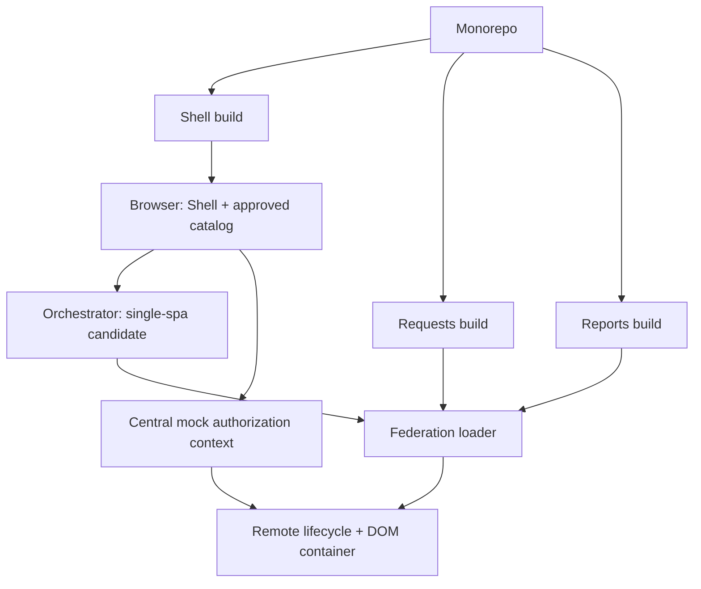

# Blueprint — טיוטה 0.1

סטטוס: תכנון, לא הוראות ביצוע מאושרות. הדמו טרם מומש.

## כוונה
פורטל קטן בעל מסגרת אחת וחלקים שנטענים מבילדים נפרדים. נלמד את ההבדל בין build, טעינת קוד, תזמור UI והרשאות.

## היקף מוצע
- Shell + שני remotes בשם Requests ו־Reports (שמות להמחשה).
- Webpack 5 + Module Federation; React כדוגמה, בכפוף לבחירת stack וגרסאות.
- single-spa כאפשרות לתזמור, לא תלות הכרחית ב־Federation.
- Monorepo אחד, ללא repositories מקוננים או submodules.
- הקשר הרשאות mock מרכזי; אין login או backend אמיתי בשלב זה.

## תרשים אחריות

## חוזים שצריך לסגור
| תחום | טיוטת חוזה |
|---|---|
| קטלוג | appId, route, remote URL/version, exposed module, approval status |
| Lifecycle | bootstrap/mount/unmount; DOM container; cleanup; errors |
| Context | getSnapshot(), can(capability), subscribe(listener) → unsubscribe |
| Routing | Shell owns top-level route; remote owns its internal route |
| UI | scoped CSS, RTL, keyboard, loading/error state |
| Dependencies | explicit shared/singleton and compatible versions |
| Delivery | versioned assets, caching, compatible catalog updates, rollback |

## גבול אבטחה
Mock context הוא כלי UX ולימוד, לא אכיפה. במערכת אמת backend מאמת זהות, הרשאה וגישה לאובייקט בכל בקשה. Remotes באותו דף אינם sandbox. לא נכניס נתונים אמיתיים או סודות לתיעוד הציבורי.

## שלבי התקדמות מוצעים
1. לבחור תרחישים ולסגור שאלות ביומן ההחלטות.
2. לאשר ארכיטקטורה וחוזים, לרבות הצורך ב־single-spa.
3. לכתוב Blueprint ביצוע עם גרסאות, workspaces, פקודות ובדיקות.
4. רק לאחר אישור: לממש Shell ו־remote ראשון, להוסיף remote שני ולבדוק גבולות.

## קריטריוני קבלה עתידיים
- Network מוכיח remoteEntry/chunks מבילדים נפרדים.
- מעברי מסלול חוזרים אינם מכפילים DOM או listeners.
- עדכון remote לא משנה hash של Shell; rollback מתועד.
- כשל remote לא מפיל ניווט או את האפליקציה השנייה.
- החלפת תפקיד מעדכנת ניווט ופעולות בלי reload; יכולת לא מוכרת נחסמת.
- תאימות תלויות ושגיאות גרסה נבדקות במפורש.

כל הקריטריונים ממתינים; אין תוצאות בדיקות מימוש עדיין.

## מקורות
- https://webpack.js.org/concepts/module-federation/
- https://webpack.js.org/plugins/module-federation-plugin/
- https://single-spa.js.org/docs/api/
- https://cheatsheetseries.owasp.org/cheatsheets/Authorization_Cheat_Sheet.html
