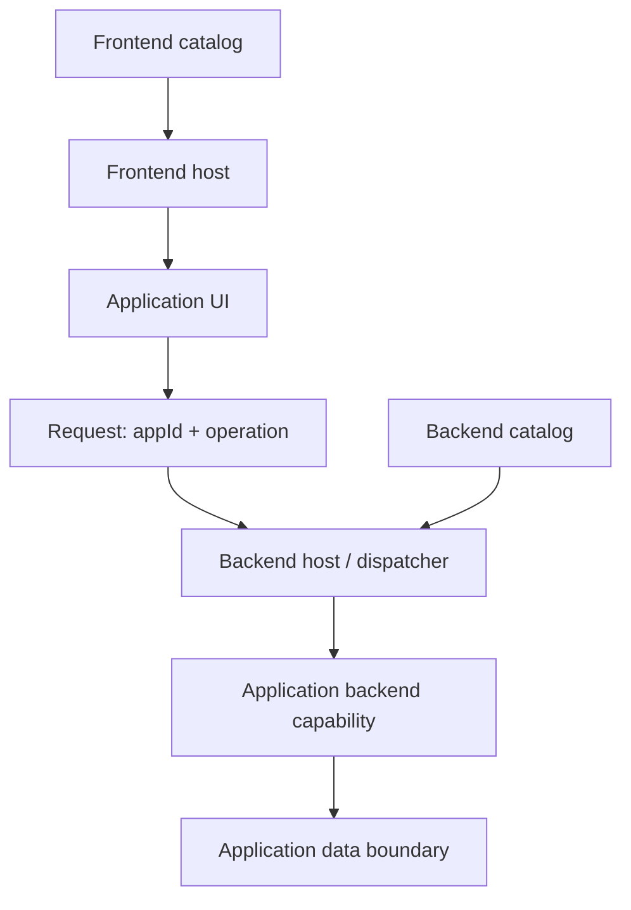

# תפיסת המערכת — טיוטה פתוחה

**סטטוס: הצעה לדיון, לא Blueprint מאושר ולא מימוש.**

## הכוונה
״קניון אחד, הרבה חנויות״: בסיס שימושי ללמידה ולהרחבה, שבו תשתיות ושירותים משותפים מאפשרים לאפליקציות עצמאות תחומית בתוך חוזי שילוב. הדמו העתידי אינו פלטפורמה ארגונית מוגמרת.

הכיוון הנבחן כולל גם frontend וגם backend. דימוי dashboard/widgets מסביר הרכבה של חלקים, אך אינו מחייב ממשק מסוים או החלטה על טכנולוגיה.

## מפת רכיבים מוצעת


החצים מציגים אחריות לוגית, לא החלטה על מספר תהליכים, שרתים או מאגרי נתונים. אין הכרח שכל אפליקציה תממש את כל שלוש השכבות.

## אפליקציה כיחידה תחומית
אפליקציה עשויה לכלול:
- **UI:** מסכים או רכיבים ודרך התחברות למארח frontend.
- **Backend:** פעולות ולוגיקה תחומית ודרך התחברות למארח backend.
- **Data:** מודל נתונים ובעלות לוגית; עדיין לא הוחלט אם נדרשת הפרדת מאגרים פיזית.

עצמאות אינה ביטול הסכמות: זהויות, גרסאות, schemas, lifecycle, שגיאות ואחריות תפעולית צריכים להיות מפורשים.

## מארחים וקטלוגים
המארח בכל צד מגלה מתוך קטלוג מאושר אילו אפליקציות או יכולות זמינות ואיך להתחבר אליהן. ״גילוי״ כאן הוא קריאת metadata מאושר והפעלת מנגנון טעינה/ניתוב שנגדיר — לא סריקה חופשית של קוד ולא יכולת שהקטלוג מספק בעצמו.

שדות אפשריים, להכרעה:
- appId יציב, שם תצוגה, גרסה וסטטוס אישור.
- יכולות UI ו־backend זמינות.
- נקודת כניסה/כתובת וחוזה תאימות לכל צד.
- פעולות מותרות ותיאור schema לקלט, פלט ושגיאות.

פתוח אם יהיה קטלוג לוגי אחד עם מבטים לכל צד או קטלוגים נפרדים. לא נבחרו מנגנון אחסון או פרוטוקול עדכון.

## הצעת RPC מתפתחת: endpoint HTTP מרכזי

**הצעה שנרשמת להמשך דיוק, לא חוזה סופי.** endpoint HTTP אחד יקבל **גוף בקשה יחיד מסוג JSON**. מזהה הפעולה יהיה שדה בתוך אותו JSON, ולא פרמטר נפרד מחוץ לו. המארח יפנה לפונקציה פנימית רשומה של האפליקציה. הנתיב ושיטת HTTP עדיין לא נקבעו; שמות השדות שלהלן הם הצעת החוזה הנוכחית, לא תקן סופי.

### צורת הזיהוי המוצעת

`appId@operationId` — מזהה האפליקציה, התו `@`, ומזהה הפעולה בתוך האפליקציה.

לצורך חוזה חד־משמעי מוצע:
- בדיוק מפריד `@` אחד, עם מזהה לא ריק מכל צד.
- התו `@` אינו מותר בתוך אף אחד משני המזהים; לא מנחשים escaping.
- מזהה חסר, מפריד חסר או כמה מפרידים → בקשה לא תקינה, ללא dispatch.
- סט התווים המותר, רגישות לאותיות גדולות/קטנות ואורכים מרביים עדיין פתוחים; לא מבצעים נרמול שקט.

### מעטפת JSON מוצעת

- **`action` הוא שדה חובה:** מחרוזת בצורת `appId@operationId`, למשל `requests@create`.
- **`payload` הוא שדה נתונים מקונן במעטפת:** קיומו, סוגו ותוכנו נקבעים לפי הפעולה וה־schema שלה. פעולה ללא נתוני קלט יכולה לא לדרוש אותו; פעולה אחרת עשויה לחייב אותו ושדות מסוימים בתוכו.
- **סדר השדות ב־JSON אינו משמעותי.** ״פרמטר ראשון חובה״ מפורש כאן כשדה חובה לוגי, לא כדרישה ש־`action` יופיע ראשון בטקסט. גם אם הוא נכתב אחרי `payload`, משמעות הבקשה זהה.
- יש להבחין לפי ה־schema בין `payload` חסר, `null` ואובייקט ריק; לא ממציאים ברירת מחדל שקטה.

דוגמה להמחשה בלבד — השדה התחומי `title` אינו דרישה עסקית מאושרת:

```json
{
  "action": "requests@create",
  "payload": {
    "title": "Example request"
  }
}
```

כל הבקשה היא JSON אחד: ה־dispatcher קורא את `action` מהמעטפת, בוחר פעולה רשומה, ומאמת את `payload` לפי ה־schema של אותה פעולה. אין רשימת פרמטרים מיקומיים ואין דרישת סדר לשדות. זו הצעה מתפתחת, ללא מימוש וללא הכרזה על תקן סופי.

### רישום מפורש לפני הפעלה

ה־dispatcher יפנה רק ל־registry מאושר שממפה זוג מזהים לפעולה חשופה במפורש, למשל `requests@list → registered handler`. שם הפעולה אינו בהכרח שם הפונקציה בקוד, ואין חשיפה אוטומטית של כל פונקציות האפליקציה.

אין `eval`, אין הרצת טקסט שהלקוח שולח, אין גישה חופשית לשמות קבצים או מאפייני אובייקט, ואין הפעלת פונקציה שלא נרשמה. appId@operationId הוא מזהה ניתוב בלבד, לא הרשאה.

### רצף בקשה מוצע

1. ה־endpoint מקבל את הבקשה ומוודא שהמעטפת תקינה.
2. המזהה מפורק לפי כלל המפריד החד־משמעי.
3. lookup מדויק ב־allowlisted registry; מזהה לא רשום אינו מופעל.
4. ה־payload נבדק מול schema של הפעולה והגרסה המתאימה. JSON תקין תחבירית לבדו אינו מספיק.
5. רק לאחר הבדיקות הנדרשות מופעל ה־handler הרשום עם ה־payload וה־context לפי החוזה שייקבע.
6. התוצאה והשגיאות חוזרות לפי schema וחוזה תגובה שטרם הוגדרו.

### שאלות שנותרו פתוחות

- **תגובה:** מעטפת אחידה או תגובה תחומית? מה schema הפלט לכל פעולה?
- **שגיאות:** הבחנה בין מעטפת לא תקינה, פעולה לא רשומה, validation, כשל תחומי וכשל תשתית; מיפוי ל־HTTP ופרטי שגיאה בטוחים.
- **גרסאות:** איפה גרסת החוזה נמצאת ואיך נשמרת תאימות בין לקוח, dispatcher ואפליקציה?
- **Auth context:** מקור ההקשר המהימן, העברתו לפעולה ונקודת האכיפה; שדות זהות ב־payload אינם מקור אמון. ה־mock הלימודי אינו אכיפה אמיתית.
- **Timeouts וביטול:** זמן קצוב לכל פעולה, התנהגות בעת ניתוק לקוח וכיצד מונעים פעולות כפולות ב־retry.
- **תפעול:** רישום handlers, אתחול, שינויים בקטלוג, מעקב אחר בקשות והתנהגות כשאפליקציה אינה זמינה.

הצעת HTTP/RPC מחדדת את גבול הכניסה, אך אינה מכריעה אם ה־handler רץ כ־plugin בתוך תהליך או בשירות נפרד. אין כאן בחירת טכנולוגיית backend ואין מימוש.

## שתי שאלות ארכיטקטורה מרכזיות

### מתי טוענים?
- **Eager:** טעינה מראש עשויה לפשט מוכנות, אך להגדיל זמן אתחול ושימוש במשאבים.
- **Lazy:** טעינה לפי צורך עשויה לחסוך משאבים, אך מוסיפה השהיה וכשל אפשרי בבקשה הראשונה.

זו החלטה נפרדת לכל צד: טעינת UI בדפדפן אינה זהה לטעינת plugin או הפעלת שירות backend. אין החלטה סופית.

### איפה backend רץ?
- **Plugin בתוך תהליך host:** פחות יחידות פריסה, אך תלות הדוקה יותר ב־runtime, במשאבים ובכשלי התהליך.
- **שירותים נפרדים:** גבולות תהליך ופריסה ברורים יותר, עם עלויות תקשורת ותפעול נוספות.

התרשים אינו בוחר אחת מהחלופות. Module Federation בדפדפן אינו החלטה על ארכיטקטורת backend ואינו תחליף לה.

## מה עדיין פתוח
1. איזו פעולה קטנה תוכיח את המסלול מקצה לקצה?
2. אילו חלקי אפליקציה חובה ואילו אופציונליים?
3. מי אחראי לקטלוג, לאישור גרסה ולעדכון שלה?
4. מתי טוענים ומתי מרעננים metadata? מה קורה אם היעד אינו זמין?
5. מה משותף למארח ומה נשאר באפליקציה?
6. האם backend הוא plugin או שירות נפרד? כיצד בודקים התאוששות מכשל?
7. מה גבול הנתונים, החוזה, הגרסאות והתצפיתיות?
8. כיצד משלבים הרשאות mock בשלב הלימודי, בלי לבלבל בינן לבין אכיפה אמיתית?

## עדכון 29.10.2026 — טכנולוגיה פתוחה, דרישת runtime ברורה

הצוות עובד ב־React. שם ה־repository אינו מחייב בחירה ב־Module Federation, ואינו משתנה כעת. נבחר מנגנון על בסיס הוכחה, לא על בסיס השם. אין עדיין בחירת stack סופית או מימוש.

### הדרישה שמכריעה את הדיון

בזמן שה־Shell כבר רץ בדפדפן, מתפרסמת אפליקציה חדשה שלא הייתה מוכרת בעת בנייתו. המארח צריך לגלות אותה ולאפשר טעינה והצגה שלה **ללא build או deploy מחודש של ה־Shell וללא רענון מלא של הדף**. זהו יעד לבדיקה, לא יכולת שכבר קיימת.

הוספת אפליקציה חדשה אינה זהה להחלפת גרסה של מודול שכבר נטען. Hot replacement, שימור state והסרת קוד מזיכרון הם שאלות נפרדות; אין התחייבות אליהם כאן.

### שלושה מושגים שאינם חלופות זהות

| מושג | השאלה שהוא עונה עליה | מה אינו מספק לבדו |
|---|---|---|
| Lazy loading | **מתי** טוענים קוד — רק כשצריך | גילוי אפליקציה חדשה וקטלוג דינמי |
| Web Components | **איך UI מתחבר** דרך custom elements, properties ו־events | פריסה, גילוי או שיתוף תלויות אוטומטי; Shadow DOM הוא אפשרות, לא חובה ולא sandbox אבטחתי |
| Module Federation | **איך צורכים מודולים מבילדים נפרדים** ומנהלים שיתוף תלויות | קטלוג עסקי מתעדכן, אישור אפליקציות וחוזי שילוב מלאים |

אפשר לשלב: למשל קוד מבילד נפרד נטען באופן lazy ומציג custom element. צוות React אינו חייב לעבור ל־Web Components כדי להשיג טעינה דינמית.

[React lazy](https://react.dev/reference/react/lazy) דוחה טעינת component עד להצגתו; routes רגילים עם imports שנקבעו בזמן build אינם מגלים אפליקציות שהתפרסמו אחריו. אפשר לעטוף loader דינמי ב־React.lazy כאשר הוא מחזיר component תואם, אך גילוי וטעינה ממקור חדש דורשים מנגנון נוסף. React שומר את תוצאת ה־loader; retry וגרסאות דורשים תכנון ולא הנחת טעינה מחדש אוטומטית.

### שתי חלופות לניסוי עתידי

| תחום | React + runtime loader פשוט | Module Federation עם remotes דינמיים |
|---|---|---|
| טעינת קוד | loader שבוחר URL מתוך קטלוג וטוען מודול בפורמט מוסכם, למשל ESM שנבנה לכך | runtime טוען remote container ומודול חשוף לפי metadata |
| React ותלויות | נצטרך לקבוע חוזה: מי מספק React, כיצד נמנע אי־תאימות או כפילות, ואיך בונים מודול בר־טעינה | shared/singleton וגרסאות מספקים מנגנון, אך עדיין נדרשת מדיניות תאימות מפורשת |
| מורכבות | פחות תשתית ייעודית בתחילה; יותר אחריות שלנו לחוזי טעינה ותלויות | תשתית ייעודית לבילדים ושיתוף; מוסיפה הגדרות ותלות ב־runtime |
| אפליקציה שלא הייתה בבנייה | אפשרי רק עם קטלוג מתעדכן ו־loader שתומך במקור חדש בזמן ריצה | אפשרי רק עם רישום/טעינת remotes בזמן ריצה; רשימה סטטית בבנייה אינה מספיקה |

החלופה הפשוטה אינה רק החלפת import ב־React.lazy. טעינת URL דינמית תלויה בפורמט התוצר, ב־bundler ובאופן פתרון imports ותלויות. בשתי החלופות צריך מקורות מאושרים, תאימות, הגדרות cross-origin/CSP לפי הפריסה וטיפול בכשל.

single-spa נשאר בחירה פתוחה לתזמור lifecycle וניווט. Web Components נשארים בחירה פתוחה לחוזה UI. לא נוסיף אותם בלי יתרון שמוצג בניסוי.

### מסלול הגילוי הנדרש בשתי החלופות

פרסום אפליקציה → עדכון קטלוג מאושר → Shell שכבר פתוח מקבל עדכון → רישום ניווט ו־loader → טעינה לפי צורך → בדיקת חוזה → הצגה או fallback מקומי.

פתוח אם עדכון הקטלוג נעשה בפעולה ידנית בתוך ה־Shell, polling או push. כל אחת יכולה להימנע מרענון מלא; הדרישה אינה מחייבת דווקא גילוי אוטומטי מיידי.

### הוכחה לפני בחירה

1. פותחים Shell עם אפליקציה A ושומרים בו state גלוי.
2. בלי לסגור את הדף, מפרסמים אפליקציה B חדשה ומעדכנים קטלוג.
3. ה־Shell מגלה את B ומציג אותה ללא reload, rebuild או redeploy שלו; ה־state נשמר.
4. שומרים ראיות: hash Shell שלא השתנה, גרסת קטלוג, בקשות Network לקוד החדש ותיעוד שהמסמך לא נטען מחדש.
5. מנסים יעד לא זמין וחוזה לא תואם: כשל נשאר מקומי, והניווט והאפליקציה הקיימת נשארים שימושיים.
6. משווים מורכבות, תאימות React, cleanup, caching, retry ויכולת הסבר. רק אז בוחרים בין החלופות.

מקורות: [Webpack Module Federation](https://webpack.js.org/concepts/module-federation/), [Web Components](https://developer.mozilla.org/en-US/docs/Web/API/Web_components). ההשוואה והניסוי הם הצעת תכנון לפרויקט, לא המלצה רשמית של הספריות.

## גבולות השלב הנוכחי
תיעוד בלבד. לא נוצרו hosts, אפליקציות, backend, APIs או מאגר נתונים. התכנון הראשוני של Shell ושני remotes נשאר נקודת מוצא אפשרית; הרחבתו תיקבע ב־Blueprint. אין כרגע הוראות התקנה/הרצה של דמו שאינו קיים.

אין כאן הבטחת security או בידוד: remotes באותו דף אינם sandbox, וניתוב backend אינו אכיפת הרשאות. הטיפול הייצורי בגבולות אמון אינו ממומש.
