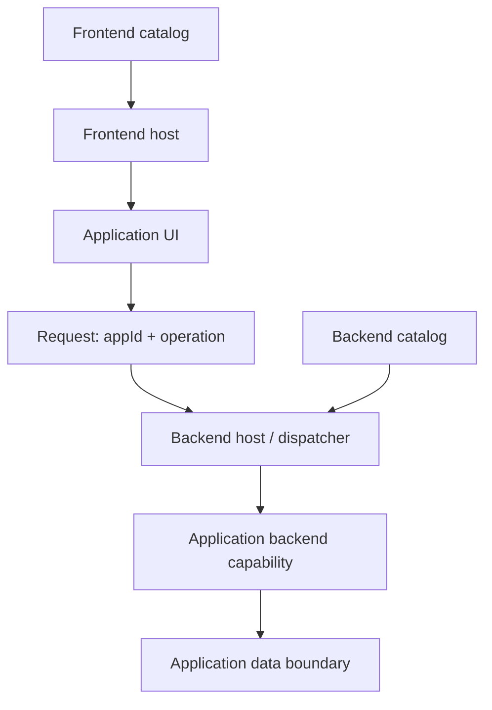

# תפיסת המערכת — טיוטה פתוחה

**סטטוס: הצעה לדיון, לא Blueprint מאושר ולא מימוש.**

## הכוונה
״קניון אחד, הרבה חנויות״: בסיס שימושי ללמידה ולהרחבה, שבו תשתיות ושירותים משותפים מאפשרים לאפליקציות עצמאות תחומית בתוך חוזי שילוב. הדמו העתידי אינו פלטפורמה ארגונית מוגמרת.

הכיוון הנבחן כולל גם frontend וגם backend. דימוי dashboard/widgets מסביר הרכבה של חלקים, אך אינו מחייב ממשק מסוים או החלטה על טכנולוגיה.

## מפת רכיבים מוצעת

החצים מציגים אחריות לוגית, לא החלטה על מספר תהליכים, שרתים או מאגרי נתונים. אין הכרח שכל אפליקציה תממש את כל שלוש השכבות.

## אפליקציה כיחידה תחומית
אפליקציה עשויה לכלול:
- **UI:** מסכים או רכיבים ודרך התחברות למארח frontend.
- **Backend:** פעולות ולוגיקה תחומית ודרך התחברות למארח backend.
- **Data:** מודל נתונים ובעלות לוגית; עדיין לא הוחלט אם נדרשת הפרדת מאגרים פיזית.

עצמאות אינה ביטול הסכמות: זהויות, גרסאות, schemas, lifecycle, שגיאות ואחריות תפעולית צריכים להיות מפורשים.

## מארחים וקטלוגים
המארח בכל צד מגלה מתוך קטלוג מאושר אילו אפליקציות או יכולות זמינות ואיך להתחבר אליהן. ״גילוי״ כאן הוא קריאת metadata מאושר והפעלת מנגנון טעינה/ניתוב שנגדיר — לא סריקה חופשית של קוד ולא יכולת שהקטלוג מספק בעצמו.

שדות אפשריים, להכרעה:
- appId יציב, שם תצוגה, גרסה וסטטוס אישור.
- יכולות UI ו־backend זמינות.
- נקודת כניסה/כתובת וחוזה תאימות לכל צד.
- פעולות מותרות ותיאור schema לקלט, פלט ושגיאות.

פתוח אם יהיה קטלוג לוגי אחד עם מבטים לכל צד או קטלוגים נפרדים. לא נבחרו מנגנון אחסון או פרוטוקול עדכון.

## ניתוב לפי appId + operation
דוגמה מושגית בלבד: `appId=requests`, `operation=list`.

1. הלקוח מבקש פעולה עבור אפליקציה מזוהה.
2. מארח backend/dispatcher בודק שהאפליקציה והפעולה מוכרות ומאושרות.
3. חוזה הבקשה קובע validation, context, שגיאות וגרסה.
4. ה־dispatcher מפנה למימוש הפעולה לפי הקטלוג.
5. התוצאה חוזרת בחוזה תגובה מוסכם.

הזוג appId+operation הוא מפתח ניתוב, **לא הרשאה** ולא שם פונקציה שמותר להריץ שרירותית. לא הוחלט אם התעבורה תהיה HTTP, RPC או אחרת, ולא נקבעה צורת URL.

## שתי שאלות ארכיטקטורה מרכזיות

### מתי טוענים?
- **Eager:** טעינה מראש עשויה לפשט מוכנות, אך להגדיל זמן אתחול ושימוש במשאבים.
- **Lazy:** טעינה לפי צורך עשויה לחסוך משאבים, אך מוסיפה השהיה וכשל אפשרי בבקשה הראשונה.

זו החלטה נפרדת לכל צד: טעינת UI בדפדפן אינה זהה לטעינת plugin או הפעלת שירות backend. אין החלטה סופית.

### איפה backend רץ?
- **Plugin בתוך תהליך host:** פחות יחידות פריסה, אך תלות הדוקה יותר ב־runtime, במשאבים ובכשלי התהליך.
- **שירותים נפרדים:** גבולות תהליך ופריסה ברורים יותר, עם עלויות תקשורת ותפעול נוספות.

התרשים אינו בוחר אחת מהחלופות. Module Federation בדפדפן אינו החלטה על ארכיטקטורת backend ואינו תחליף לה.

## מה עדיין פתוח
1. איזו פעולה קטנה תוכיח את המסלול מקצה לקצה?
2. אילו חלקי אפליקציה חובה ואילו אופציונליים?
3. מי אחראי לקטלוג, לאישור גרסה ולעדכון שלה?
4. מתי טוענים ומתי מרעננים metadata? מה קורה אם היעד אינו זמין?
5. מה משותף למארח ומה נשאר באפליקציה?
6. האם backend הוא plugin או שירות נפרד? כיצד בודקים התאוששות מכשל?
7. מה גבול הנתונים, החוזה, הגרסאות והתצפיתיות?
8. כיצד משלבים הרשאות mock בשלב הלימודי, בלי לבלבל בינן לבין אכיפה אמיתית?

## גבולות השלב הנוכחי
תיעוד בלבד. לא נוצרו hosts, אפליקציות, backend, APIs או מאגר נתונים. התכנון הראשוני של Shell ושני remotes נשאר נקודת מוצא אפשרית; הרחבתו תיקבע ב־Blueprint. אין כרגע הוראות התקנה/הרצה של דמו שאינו קיים.

אין כאן הבטחת security או בידוד: remotes באותו דף אינם sandbox, וניתוב backend אינו אכיפת הרשאות. הטיפול הייצורי בגבולות אמון אינו ממומש.
